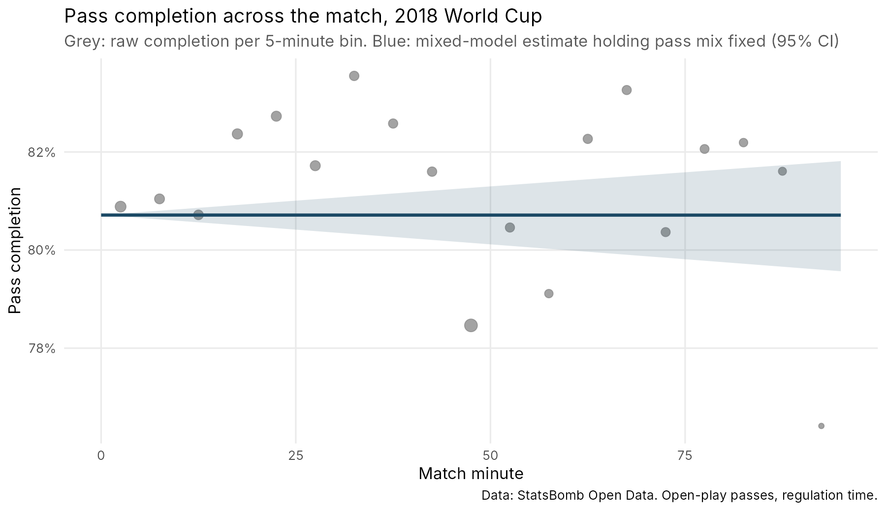

# Decision Decay

**Do footballers make worse passes late in a match?**

I started this for the AQX Sports Analytics Data Bowl with one match (the 2018 World Cup final). The model hinted at a late-game drop, but with 846 passes the minute effect had p = 0.64, which tells you nothing. So I reran the analysis on all 64 matches of the 2018 World Cup: **56,206 open-play passes from 601 players**.

**Short answer: no.** Raw completion does dip in some windows, but once you control for *what kind* of pass is being played, the effect of match time disappears.



## What the models say

Odds ratio for completing a pass, per 15 extra minutes:

| Model | OR | 95% CI | p |
|---|---|---|---|
| minute only | 0.987 | 0.975 – 0.999 | 0.03 |
| + distance, pressure, pitch position, pass height | 1.002 | 0.989 – 1.016 | 0.75 |
| + score state | 1.000 | 0.985 – 1.015 | 0.99 |
| + random intercept per player (`glmer`) | 1.000 | 0.985 – 1.015 | 0.99 |

The naive model finds a small, "significant" decline. It goes away once pass difficulty is in the model, and it stays at zero after accounting for game state and the fact that the same 601 players produce all the rows. The confidence interval is tight, so this isn't a power problem anymore: if there is a late-game effect on execution, it's smaller than about 1.5% in odds per 15 minutes.

What *does* change over the match is the pass mix:

- Passes start further up the pitch as the game goes on (mean start x goes from 57 to 62), and passes played further forward fail more often (OR ≈ 0.92 per 10 yards).
- The share of high balls rises at the start of the second half and in the last 15 minutes.
- Pressure (OR ≈ 0.80) and pass height (high ball OR ≈ 0.06 vs ground) are by far the strongest predictors.

So the "players get tired and sloppy" story is mostly a composition effect: teams play riskier, more advanced passes late on, and those fail more often no matter when they're played.

Two caveats:
- **Pass choice could itself be the fatigue signal.** Tired players might pick more hopeful long balls. This analysis only shows that execution, given the pass, doesn't get worse.
- **The dip at minutes 45–50** mixes first-half stoppage time with the start of the second half (StatsBomb counts both as minute 45+). I haven't separated them.

## Data and method

- **Source:** [StatsBomb Open Data](https://github.com/statsbomb/open-data), FIFA World Cup 2018 (competition 43, season 3).
- **Rows:** open-play passes in regulation time. I dropped set pieces (corners, free kicks, throw-ins, goal and kick-offs) and passes with outcome `Unknown` or `Injury Clearance`.
- **Score state:** rebuilt from the event stream (goals and own goals) from the passing team's point of view. A goal only counts for passes that come *after* it.
- **Models:** logistic regression in R (`glm`), then a mixed model with a player random intercept (`lme4::glmer`). The adjusted curve in the chart is the average predicted probability over the real passes with only the minute changed.

## Run it

```bash
pip install -r requirements.txt
python src/data_processor.py        # downloads ~180 MB of JSON once, writes data/passes.csv
Rscript src/cognitive_model.R       # needs dplyr, ggplot2, lme4; ~2 min for the mixed model
```

`data/passes.csv` is committed, so you can skip the first step.

## Files

```
src/data_processor.py     StatsBomb JSON -> one row per pass
src/cognitive_model.R     models, tables in results/, chart in visuals/
data/passes.csv           56k open-play passes (plus extra-time rows, filtered in R)
results/                  model outputs as CSV
```

## Next

- Model pass *choice* (e.g. probability of a long/high pass) as the outcome, to test the fatigue-shows-up-in-decisions idea directly.
- Add other tournaments from the open data (Euro 2020, WC 2022) to check this isn't specific to 2018.
